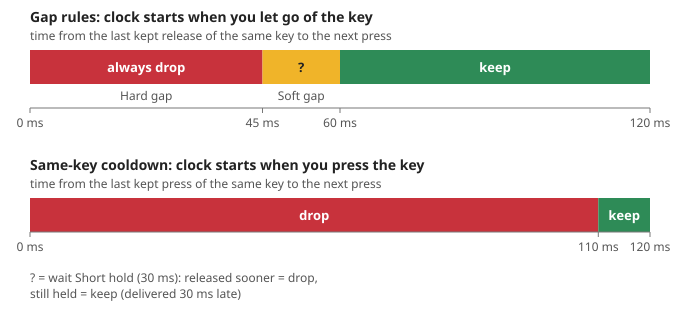
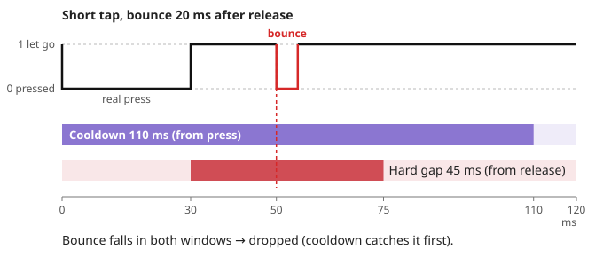
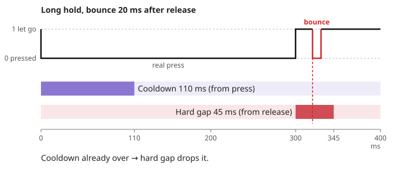

# KaiOS keyboard debounce (Nokia 2780)

Replaces the stock keyboard's served code with a patched build that adds a
configurable **same-key debounce/cooldown**, without root, without flashing, and
without touching `/system`. The suggestion bar is pink so you can tell the
patched build is live.

**Quick start:** [SETUP.md](SETUP.md) · **How/why it works:** [NOTES.md](NOTES.md)

## What this repo contains

- `app/` — patched keyboard source (stock app + `js/debounce*.js` +
  `js/predict*.js` + `config.html`).
- `build/deploy/application.zip` — signed package (OStore-style signature block).
- `build/deploy_selfcontained.js` — deploy module with the package embedded, so
  the phone needs no XHR (the System page's CSP blocks it).
- `deploy/fs_recover.js` — rollback to the stock keyboard.
- `tools/` — build, packaging, signing, and the dev server.
- `profiles/100ms-cooldown.json` and `profiles/1s-cooldown.json` — reference
  profiles.
- `profiles/predict.json` — example prediction rules (the built-in defaults).
- `docs/img/` — README diagrams (regenerate with `tools/gen_readme_svgs.py`).

## The ADB key (where it comes from)

We did **not** generate a key. The phone trusts the **JScalated shared ADB
key**, which is installed by JScalated's "Enable ADB" XPI. Download the matching
computer half from the official JScalated site, search yourself.

That bundle contains `adbkey` (private half) and `adbkey.pub` (public half), and
the private half is **intentionally public** — it is a community key, not a
secret. Because of that:

- use **USB ADB only**, never JScalated's wireless ADB option;
- keep the key out of this repo (`.gitignore` blocks `adbkey`, `*.pem`, and
  `jscalated-adb-key*`);
- re-download it if you lose it. It is not recoverable from the phone.

Extract it once to a durable location on the Mac:

```sh
mkdir -p ~/.config/kaios
unzip -o jscalated-adb-key.zip -d ~/.config/kaios
chmod 600 ~/.config/kaios/adbkey
export ADB_VENDOR_KEYS=~/.config/kaios/adbkey   # or put this in ~/.zshrc
```

Every `adb` command in this repo assumes that key at
`~/.config/kaios/adbkey`. The `ADB_VENDOR_KEYS` variable is read when the adb
server starts; `adb reverse` must be re-run whenever a phone is replugged or
rebooted.

## The path for a new phone

A fresh phone has no ADB. First enable it with JScalated, then reboot:

1. USB connect, **Settings → Storage → USB storage**.
2. jscalated.netlify.app → **Load JScalated** → the two lines:
   ```
   javascript:document.createElement('script')
   javascript:document.write(name)
   ```
3. In the panel press **Enable ADB**, then **fully power off/on**.

Then on the Mac:

```sh
python3 tools/serve.py
# JScalated shared key, extracted once (see SETUP.md):
ADB_VENDOR_KEYS=~/.config/kaios/adbkey tools/reverse-all.sh
```

And on the phone (loader must be redone after the reboot):

1. jscalated.netlify.app → **Load JScalated** → the two lines again.
2. Then:
   ```
   javascript:import('http://127.0.0.1:8088/d')
   ```
3. Reboot. Pink bar = patched keyboard live.

Full details: [SETUP.md](SETUP.md). After editing anything under `app/`, run
`make build` and redeploy with a fresh `/d2`, `/d3`, … (see
[SETUP.md → Changing the code](SETUP.md#changing-the-code-rebuild-and-redeploy)).

Tune it at `http://keyboard.localhost/config.html` — no redeploy, survives
reboot. Default same-key cooldown is 110 ms in every input mode; the page also
has 1 s and defaults buttons.

## How the settings work

A **bounce** is the key contact chattering and producing a ghost repeat of the
same key: you press 4 once and get "44". Every rule compares a press only with
the previous *kept* press of the **same key**, so typing different keys quickly
is never affected.

Only `0`–`9`, `*`, `#`, Backspace and the arrows are filtered. Select has its
own simpler cooldown (below). Call, End, the soft keys and everything else are
never touched. Backspace on an empty field always passes through, so Back still
works.



| Setting | Default | What it does |
| --- | --- | --- |
| Enabled | on | Master switch for the whole filter. |
| Hard gap | 45 ms | A press that comes less than this long after you **let go** of the same key is always dropped. |
| Soft gap | 60 ms | Between hard gap and soft gap the press is held back for *Short hold* to decide. |
| Short hold | 30 ms | In the soft window: released within 30 ms → bounce, dropped. Still held → real, delivered 30 ms late. |
| Cooldown: T9 / Abc / abc / ABC / 123 | 110 ms each | A press that comes less than this long after the last kept **press** of the same key is dropped. One value per input mode. |
| Select cooldown | 1000 ms | A second Select within this long after the last one is dropped. `0` turns it off. |
| Show JS marker | off | A 10 px bar left of the suggestion strip: green if the current mode's cooldown is > 0, yellow if it is 0. |
| Debug console log | off | Logs every decision (`[debounce] …`, `[predict] …`) to the console / `adb logcat`. |

The multi-tap modes (Abc / abc / ABC) depend on fast repeats of the same key
(2-2-2 = "c"), so keep their cooldown short. 123 and T9 can go higher, since
you rarely need the same key twice in quick succession there.

**Select cooldown.** In predictive mode, the first Select commits the
highlighted word. If that press bounces, the second Select is no longer
committing a word, so it goes to the app, and in Messages that sends the text.
The Select cooldown drops that ghost. To send on purpose, wait at least **1 s**
after the Select that picked the word.

### Do they override each other?

No. A press has to pass **both** checks, and the cooldown runs first
(`app/js/debounce.js`). They measure from different moments: the cooldown
counts from when you **press** a key, the gap rules count from when you **let
go**. After a short tap both windows cover the bounce:



After a long hold the cooldown has already run out by the time you let go, so
only the gap rules can catch a bounce:



### Profiles

The **100 ms** and **1 s** buttons (and `profiles/*-cooldown.json`) set hard
gap, soft gap and short hold to 0 and set all five cooldowns to 100 or 1000 ms.
They rely on the cooldown alone, so a bounce right after a long hold is not
caught. That mostly matters for 100 ms. The 1 s profile also blocks fast
multi-tap: 2-2-2 → "c" becomes impossible.

## Prediction rules (predictive / T9 mode)

After TouchPal builds its word list, the keyboard can move a word of your choice
to the front, so it becomes the default:

- `4` → always **"I"** (instead of "g").
- `4663` → **"home"** after headed / going / went…, **"good"** after very / so /
  pretty…, otherwise TouchPal's order.

Rules are keyed by the exact digit sequence. Sequences without a rule are not
touched and cost one object lookup per key press.

```json
{
  "enabled": true,
  "rules": {
    "4":    { "first": "I" },
    "9292": { "first": "wawa" },
    "46": {
      "I'm": ["^", "and", "but", "because"],
      "go":  ["to", "let's", "can", "will"]
    },
    "4663": {
      "home": ["headed", "going", "went", "back"],
      "good": ["very", "so", "pretty", "a"]
    }
  }
}
```

- `"first"`: always put that word first. It is added even if TouchPal doesn't
  offer it (`9292` → "wawa").
- Any other key is a word, mapped to the previous words that should put it
  first. If several words match, the one listed first in the rule wins.
  `"first"` beats them all. With no match, TouchPal's order is kept.
- `"^"` means *no previous word*: the start of the field, or after `.` `!` `?`
  or a new line.
- Matching ignores case ("I" matches `"i"`), and apostrophes count as part of
  a word ("there's"). Any characters are allowed in a word ("D&D"). Capitals
  in a rule word are kept ("I", "I'm"). An all-lowercase rule word keeps
  TouchPal's casing if TouchPal offers it.
- Arrow keys still scroll through the whole list after a reorder.

The full default set is in [`profiles/predict.json`](profiles/predict.json).
There are three ways to change it, all on `config.html` under **Prediction
rules**:

1. **Edit on the phone**: change the JSON, **Validate**, **Save**.
2. **Load from URL** via the dev server: run `python3 tools/serve.py` and
   `tools/reverse-all.sh` (`adb reverse tcp:8088 tcp:8088`), then press
   **Load** with `http://127.0.0.1:8088/profiles/predict.json`, and **Save**.
3. **Any URL that sends CORS headers**, e.g. a raw GitHub file or a gist.

Saved rules apply within about 1 s, with no reboot. The **Test a rule** box
shows what a rule does to a sample list without typing. Run the unit tests with
`node tools/test_predict.mjs`.
